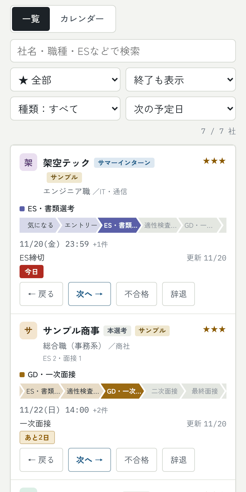
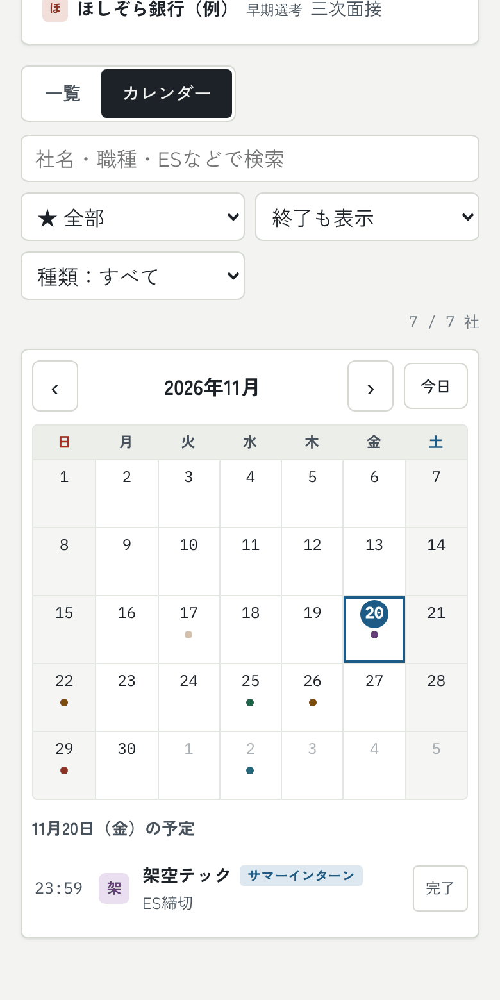
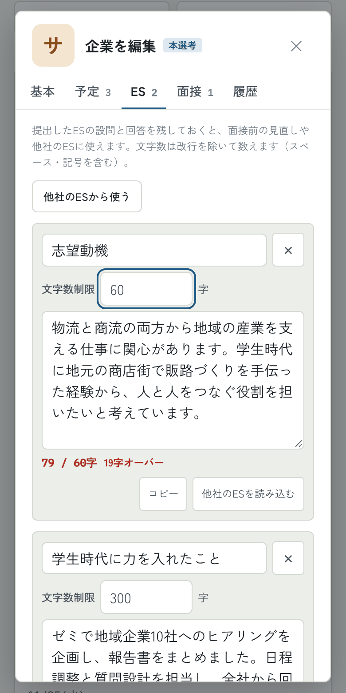
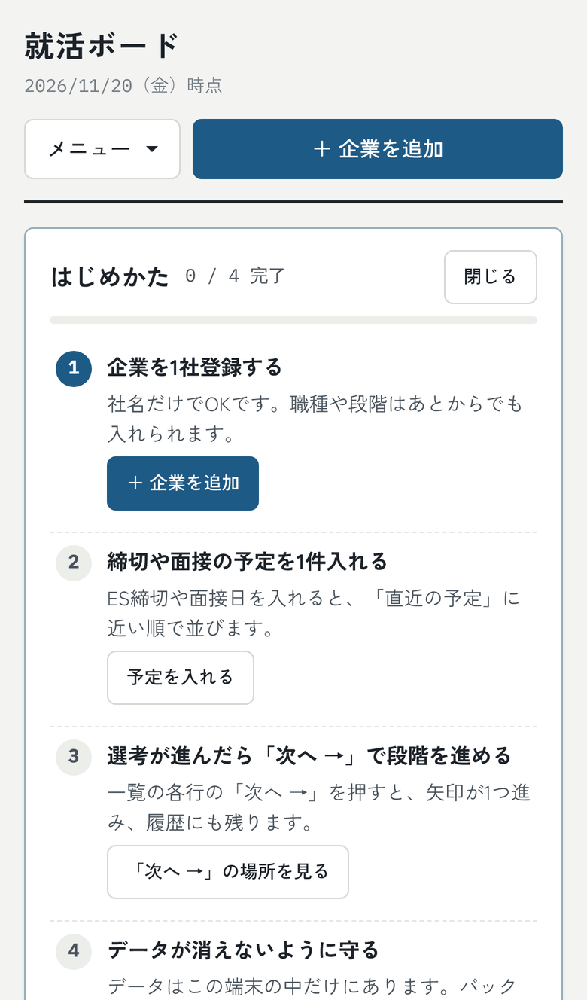
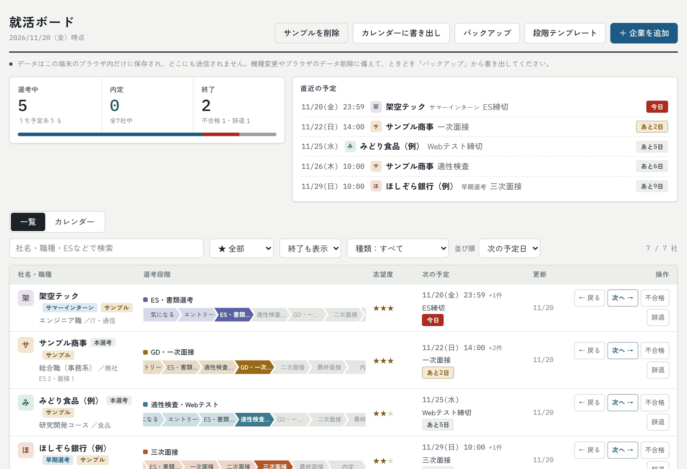
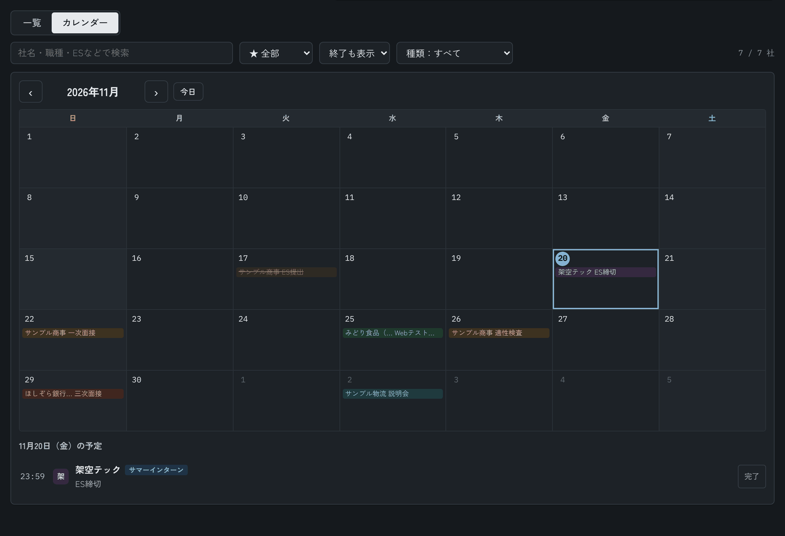
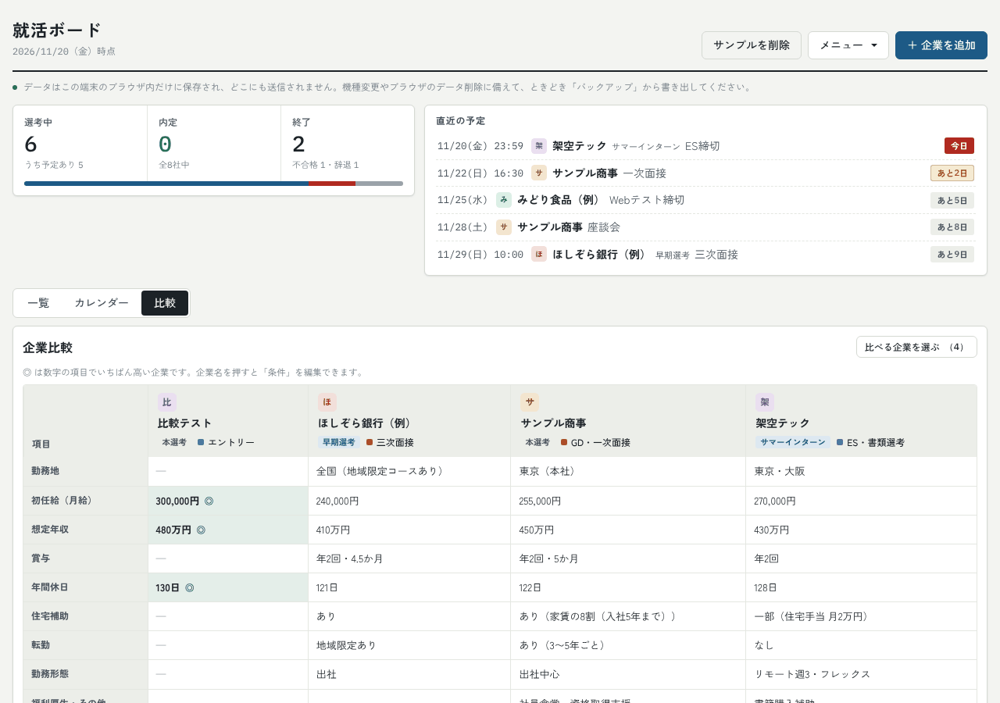
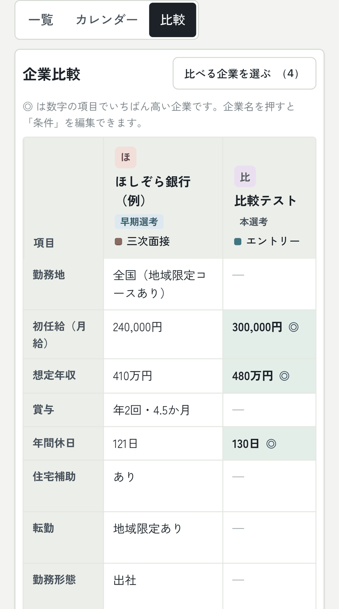

# 就活ボード

応募した企業を **社名・職種（コース）・いまの選考段階・次の予定** で一覧できる、就活用のシンプルなトラッカーです。
20〜40社を同時に受けていても、どこまで進んでいるかが矢印のステップでひと目で分かります。

## ▶ アプリを開く

**https://saitos-jp.github.io/Job-hunting-management/**

登録不要・無料で使えます。スマホなら下の「インストール」の手順でホーム画面に追加するのがおすすめです。

はじめて開くと「はじめかた」が表示され、企業の登録 → 予定の入力 → 段階を進める → バックアップ、の4ステップを順に案内します。画面の見方は「メニュー → 使い方ツアー」、よくある質問は「メニュー → 使い方」で確認できます。

## 画面

<table>
  <tr>
    <td></td>
    <td></td>
    <td></td>
    <td></td>
  </tr>
  <tr>
    <td align="center">一覧</td>
    <td align="center">カレンダー</td>
    <td align="center">ESの記録</td>
    <td align="center">はじめかた</td>
  </tr>
</table>

 

（画面はすべて架空のサンプルデータです）

## できること

- **はじめかた・使い方**：最初に「はじめかた」のチェックリスト（実際の登録内容で自動的にチェック）、画面の要所を順に案内する「使い方ツアー」、よくある質問の「使い方」。企業の追加は社名だけで始められ、細かい項目は「詳しく入力する」にまとめています
- 選考段階：初期状態は 気になる → エントリー → ES・書類選考 → 適性検査・Webテスト → GD・一次面接 → 二次面接 → 最終面接 → 内定（不合格・辞退も記録できます）
- 選考段階は企業ごとに編集できます（例：三次面接を足す、Webテストを消す、名前を変える、並べ替える）。編集画面の「この企業の選考段階を編集」から
- 「段階テンプレート」で、これから追加する企業の初期の段階の並びを決められます（登録済みの企業には影響しません）。「初期状態に戻す」も可能
- 内定にあたる段階に「内定」の印を付けると、その段階（とその後の内定承諾などの段階）にいる企業が「内定」として数えられます。初期状態では「内定」に印が付いています。印のない並びでは、最後まで進んでも内定に数えません
- 予定（ES締切・面接日など）は1社に複数登録でき、済んだものは「完了」にできます。一覧には一番近い未完了の予定と残りの件数（+N件）を表示
- 「直近の予定」に全企業の今日以降の予定が近い順に並びます（「今日」「明日」「あとN日」）。期限が過ぎた未完了の予定は下に分けて表示し、「完了」ボタンで片付けられます
- **カレンダー表示**：「一覧」「カレンダー」を切り替えられます。月ごとのカレンダーに予定が並び、日付を選ぶとその日の予定の一覧と「完了」ボタンが出ます
- **企業比較**：「比較」画面で、内定した企業や迷っている企業の勤務地・初任給・想定年収・年間休日・住宅補助・転勤・自分の評価などを横に並べて比べられます（数字はいちばん高い企業に ◎）。条件は企業の編集画面の「条件」タブで入力
- **カレンダーアプリへの書き出し**：「カレンダーに書き出し」で予定を .ics ファイルにして、iPhone のカレンダーや Google カレンダーに取り込めます。通知（1週間前・3日前・前日・当日朝9時から選択）はカレンダーアプリが出します。企業ごとの書き出しも可能。前回の書き出し以降に増えた・変わった・なくなった予定を表示し、「新しい予定だけ書き出す」で重複なく追加できます（日時を変えたときは専用カレンダーの作り直しを案内）
- **インターンと本選考の区別**：企業ごとに「選考の種類」（本選考・サマーインターン・早期選考など、自由入力も可）を付けられ、種類で絞り込めます。「同じ企業で別の選考を追加」で、社名やアイコンを引き継いだ別の選考を作れます
- **ES・面接の記録**：ESの設問と回答、面接ごとの聞かれた質問と振り返りを企業ごとに残せます。ESは文字数制限を入れると「123 / 400字」「あと277字」のように表示（改行を除いて数えます）
- **ESの使い回し**：「他社のESから使う」で、ほかの企業のESを検索・設問の種類で絞り込み、コピーして追加・置き換えできます。各ESの「コピー」でクリップボードにも
- 検索（社名・職種・種類・メモ・ES・面接の記録）、志望度・種類・選考中のみの絞り込み、並び替え（次の予定日／志望度／段階／更新日）
- 「次へ →」「← 戻る」「不合格」「辞退」ワンタップで段階を更新。不合格・辞退にした企業は「選考中に戻す」で直前の段階に戻せます。変更はすべて履歴に残ります
- 企業ごとのアイコン（画像を選ぶか貼り付け。未設定なら社名の頭文字）
- ホーム画面に追加してアプリとして使え、オフラインでも動きます

## プライバシー

- 入力したデータは **この端末のブラウザ内（IndexedDB）だけ** に保存されます。サーバーへの送信、アカウント登録、アクセス解析は一切ありません。
- 外部への通信はありません。フォントもアプリに同梱しており、通信先は公開しているこのサイト自身だけに制限しています（Content-Security-Policy）。
- データは端末・ブラウザごとに別々です。iPhone と PC で同じデータを見たいときは、下の「バックアップ」で移してください。
- プライベートブラウズなど保存できない環境では、画面上に警告が出ます（閉じるとデータは消えます）。

## インストール（ホーム画面に追加）

**iPhone / iPad（Safari）**
1. Safari で https://saitos-jp.github.io/Job-hunting-management/ を開く
2. 共有ボタン（□に↑）→「ホーム画面に追加」→「追加」
3. ホーム画面のアイコンから起動すると、全画面のアプリとして使えます

**Android（Chrome）**
1. Chrome で https://saitos-jp.github.io/Job-hunting-management/ を開く
2. メニュー（︙）→「アプリをインストール」または「ホーム画面に追加」

**PC（Chrome / Edge）**
- アドレスバー右端のインストールアイコン、またはメニュー →「アプリをインストール」

## バックアップと復元

データは端末の中にしかないため、機種変更やブラウザのデータ削除で消えてしまいます。ときどき書き出しておくのがおすすめです。

- **書き出し**：右上の「バックアップ」→「書き出し」で `shukatsu-backup-YYYYMMDD.json` が保存されます（予定、選考の種類、ES・面接の記録、比較の条件、企業ごとの選考段階、段階テンプレート、アイコン画像も含みます）。
- バックアップファイルは暗号化されていません。自分だけが開ける場所に保存し、チャットやメールで送るのは避けてください。
- しばらく書き出していないときは、画面の上にお知らせが出ます（まだ一度も書き出していない場合や、前回から7日以上たって変更がある場合）。
- 以前のバージョンで書き出したファイルも読み込めます（選考段階は初期状態の8段階、次の予定は1件の予定として扱われます）。
- 読み込む前にファイル全体を確認し、問題があれば内容を表示して何も変更しません。読み込み中に失敗した場合も、今のデータはそのまま残ります。
- **読み込み**：「バックアップ」→「読み込み」でファイルを選び、
  - **追加する**：今のデータを残したまま加えます
  - **置き換える**：今のデータをすべて消してから読み込みます（段階テンプレートもファイルの内容になります。元に戻せません）

## フォントのライセンス

`fonts/` に同梱している Zen Kaku Gothic New と IBM Plex Mono は SIL Open Font License 1.1 で配布されています。ライセンス本文は各フォルダの `OFL.txt` を参照してください。

## 設計

端末内だけに保存し、外部と通信しない作りです。データの形式、保存と復元の仕組み、セキュリティ、更新の方法などは [docs/DESIGN.md](docs/DESIGN.md) にまとめています。変更の履歴は [CHANGELOG.md](CHANGELOG.md) を参照してください。スマホの実機での確認手順は [docs/TESTING.md](docs/TESTING.md) にあります。

## 開発

- テスト：`npm test`（Node.js 22 以上。追加のパッケージは不要です）
- ローカルで確認：`python3 -m http.server` を実行して http://localhost:8000/ を開く
- 公開するときは `sw.js` の `VERSION` を上げ、`index.html` の「バージョン」と `CHANGELOG.md` の新しい項目を同じ番号にしてください（テストで一致を確認しています）
