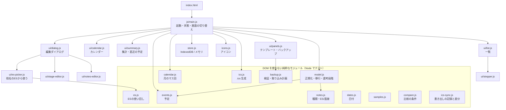

# 就活ボード 設計メモ

## 目的と方針

応募した企業ごとに「どの職種・コースに」「いまどの段階か」「次の予定はいつか」を一覧できるようにする、就活用のトラッカーです。

- **端末内保存**：データはブラウザの IndexedDB にだけ保存し、サーバーやアカウントを持たない
- **オフライン**：Service Worker でアプリ本体をキャッシュし、通信がなくても使える
- **外部通信なし**：フォントも同梱し、CSP で通信先を公開元のサイト自身に限定する
- **ビルド不要**：素の HTML / CSS / ES モジュールだけで構成し、GitHub Pages にそのまま置ける
- **壊さない**：古いデータやバックアップは読み込み時に移行し、復元は全部成功するか何も変えないかのどちらか

## 構成

UI モジュールは `$`/`esc`（ui/html.js）で DOM に触れ、データの判断はすべて純粋なモジュールに任せます。純粋なモジュールは `window` や DOM を参照しないので、Node.js でそのままテストできます。

## データモデル

### 企業（companies ストア、キー `id`）

| フィールド | 内容 |
| --- | --- |
| `id` | ランダムな文字列 |
| `name` / `position` / `industry` | 社名・職種/コース・業界 |
| `kind` | 選考の種類（本選考・サマーインターンなど。自由入力、未設定は「本選考」） |
| `priority` | 志望度 1〜3 |
| `stages` | この企業の選考段階 `[{id, label, offer}]`（並び順どおり。`offer: true` は1つまで。その段階とそれ以降が「内定」扱い。印がなければ内定なし） |
| `stage` | いまの段階の `id`、または終了状態 `rejected` / `declined` |
| `history` | 段階の変更履歴 `[{stage, at, label}]`（ラベルも保存し、段階の名前変更・削除後も読めるように） |
| `events` | 予定 `[{id, at, label, done}]`（`at` は ISO 日時。日付だけの予定は現地時刻の 0:00） |
| `notes` | `{es: [{id, question, answer, limit, updatedAt}], interviews: [{id, date, title, questions, reflection}]}`（`limit` は文字数制限 1〜10000 または null。文字数は改行を除いて数える） |
| `url` / `memo` | マイページ URL（http/https のみ）・自由メモ |
| `compare` | 比較の条件 `{location, salary, annual, bonus, holidays, housing, housingNote, transfer, transferNote, workstyle, benefits, ratings: {work, growth, comfort, stable}}`（数値は範囲外なら null、選択肢は決まった値のみ、評価は 1〜5） |
| `iconId` | icons ストアのキー（なければ社名の頭文字を表示） |
| `example` | サンプルデータかどうか |
| `updatedAt` | 更新日時 |

### その他のストア

- **settings**：`template`（新しい企業に使う段階の並び `{stages}`）、`lastBackupAt`、`icsExport`（カレンダー書き出しの記録。下記）、`compareIds`（比較に並べる企業。未設定なら内定の企業と条件を入れた企業）
- **icons**：キー `iconId`、値 `{type, data: ArrayBuffer}`（128×128 に縮小した WebP/PNG。古い Safari の Blob 保存の問題を避けるため ArrayBuffer で保存）

## 保存とトランザクション

- 書き込みは1件ずつ順番に実行（`serial()`）し、完了を待ってから再読み込みして画面を描き直します
- **バックアップの復元**は次の順で行います
  1. ファイル全体を検証（JSON、アプリ名、版、全企業、テンプレート、全アイコン）。1か所でも問題があれば内容を表示して終了し、何も変更しません
  2. アイコンの data URL を事前にすべてバイト列に変換（IndexedDB のトランザクションは、IndexedDB 以外の非同期処理を待つと自動で確定してしまうため）
  3. companies・icons・settings をまとめた **1つの readwrite トランザクション**で、置き換えなら `clear()` してから全件 `put`、追加なら衝突する ID を振り直して `put`
  4. `complete` を受けてから成功を表示。途中で例外が出たら `abort()` し、元のデータがそのまま残ります
- IndexedDB が使えない環境（プライベートブラウズなど）ではメモリ上のストアに切り替え、警告を表示します。メモリ版の復元も、新しい Map を組み立ててから最後に差し替えることで全部か無しかを保ちます

## 移行とバージョン

- **レコード**：読み込みのたびに `normalize()` を通します。欠けた項目は既定値（段階は初期の8段階、種類は「本選考」、記録は空）になり、旧形式の `nextDate`/`nextLabel` は予定1件に変換します
- **IndexedDB**：DB バージョン 2（settings ストアを追加）
- **内定の印**：`offer` を持たない古い段階の並び（レコード・テンプレート・v1〜v4 のバックアップ）は、id が `offer` の段階、なければ名前に「内定」を含む最後の段階に印を付けます。どちらもなければ印なし（最後の段階だからという理由では付けません）。新しい形式ではすべての段階に `offer` の真偽値を保存するので、利用者が印を外した並びが読み込み時に勝手に戻ることはありません
- **バックアップファイル**：`version` 1〜6 を読み込み可能（v2 で選考段階とテンプレート、v3 で予定、v4 で種類と ES/面接の記録、v5 で内定の印と ES の文字数制限、v6 で比較の条件）。より新しい版は読み込みを断ります

## セキュリティ

- **CSP**：`default-src 'self'`、`script-src 'self'`。外部のスクリプト・フォント・通信先はありません
- **エスケープ**：画面に出すユーザー入力はすべて `esc()` を通してから HTML に入れます
- **入力の検証**：マイページ URL は http/https のみ（`javascript:` などは保存しない）。バックアップ内のアイコンは PNG/JPEG/WebP/GIF のみ受け付け、先頭のバイトが形式と一致するかも確認します（SVG は不可）。文字数・件数にも上限があります
- **第三者への送信なし**：アクセス解析・広告・外部 API は使いません
- **公開元の保護**：GitHub アカウントには2段階認証を設定してください。アプリのコードを書き換えられると、利用者の端末上のデータを読めるコードを配信できてしまうためです
- バックアップファイルは暗号化していません（画面と README で注意を表示）

## PWA と更新

- `sw.js` はアプリ本体（HTML・CSS・JS・アイコン・フォント定義）を `shukatsu-shell-<VERSION>` にキャッシュします
- ページ・JS・CSS・manifest はネットワーク優先です。ブラウザの HTTP キャッシュを通さずサーバーに確認する（`cache: "no-cache"`）ので、ページとスクリプトが常に同じ版になります。保存済みのものはオフライン時だけ使います
- 新しい版のインストール時は `cache: "reload"` で取得し、古いファイルをキャッシュに入れないようにしています。`sw.js` 自体も `updateViaCache: "none"` で登録し、開くたび・画面に戻るたびに更新を確認します
- アイコンとフォントはキャッシュ優先です
- （以前は JS/CSS を「キャッシュを返しつつ裏で更新」にしていたため、HTML だけ新しく JS が古い状態になり、新しい画面が出ないことがありました）
- 公開のたびに `VERSION` を上げると古いキャッシュが削除されます

## テストと CI

- `npm test`（Node.js 標準の `node --test`、依存パッケージなし）
- 対象：日付計算（月・年またぎ、うるう年）、期限表示、選考段階の操作と移行、予定の選び方、カレンダーのマス目、.ics（エスケープ・折り返し・終日/時刻あり・通知・UID）、種類と記録の正規化・検索、バックアップの検証と取り込み計画、メモリストアの全部か無しかの反映
- テストは `TZ=Asia/Tokyo` を設定してから実行し、端末のタイムゾーンに左右されないようにしています
- GitHub Actions（`.github/workflows/test.yml`）で push と pull request のたびに実行

## カレンダー書き出しの記録（ics-sync.js）

.ics ファイルはその時点の写しで、iPhone のカレンダーは同じファイルを開き直すと予定を二重に追加し、既存の予定を更新しません。Google カレンダーの取り込みは同じ UID の予定を更新することがありますが、なくなった予定は消しません。そこで、

- 書き出すたびに `icsExport = {at, items: {UID: {h, k, seq, at, label, company}}}` を端末に保存します。`h` はファイルに書く内容すべて（日時・内容・社名・種類・職種・選考段階・URL）のハッシュ、`k` はカレンダーで目に見える部分（日時・内容・社名・種類）のハッシュです
- `diffExport()` が今の予定と比べて「新しい予定（未書き出しで今日以降）・変更・なくなった予定（削除・完了・不合格/辞退）」を出します。お知らせに数えるのは、目に見える変更（`k` の違い）となくなった予定だけで、選考段階が進んで説明欄だけ変わったものは数えません
- 「新しい予定だけ書き出す」は記録に足すだけ（merge）、「すべて書き出す」は記録を置き換えます（full）。`h` が変わった UID は `SEQUENCE` を1つ上げ、`LAST-MODIFIED` とともに書き出します
- なくなった予定を `STATUS:CANCELLED` で書き出すことはしていません。iPhone のカレンダーでは取り消しとして扱われず、新しい予定として増えてしまうためです。代わりに専用カレンダーの作り直しを案内します

## はじめての人向けの案内

- **はじめかた**（`js/onboarding.js` と `ui/onboarding-card.js`）：4つのステップの完了は、クリックの記録ではなく実際のデータから毎回判定します（自分で登録した企業がある／予定がある／履歴が2件以上ある＝段階を変えた／`lastBackupAt` がある）。サンプル（`example: true`）は数えません
- 表示するかどうかは `checklistVisible()` で決めます。閉じたら非表示（localStorage）、全部終わった状態を一度表示したら次回から非表示、メニューから開いたときは常に表示。表示中はホーム画面追加の案内とバックアップのお知らせを出しません（4つ目のステップが両方を兼ねるため）
- **使い方ツアー**（`ui/tour.js`）：外部ライブラリなし。対象の要素の位置に box-shadow でくり抜いた暗幕を重ね、説明を出します。対象が画面にない手順は `tourStepsFor()` で飛ばします。スマホでは説明を画面の上下に寄せたシートにし、対象と重ならないようにします。`role="dialog"`・`aria-modal`、← → Esc、終了後は元の場所へフォーカスを戻します。自動では始まりません
- **追加画面**：新しい企業では必須項目だけを見せ、ほかは「詳しく入力する」（`
`）に。既存の企業の編集では最初から開いています

## 既知の制限

- 端末間の同期はありません（バックアップファイルで移します）
- iOS のホーム画面アプリから通知を出す仕組みは使っていません。締切の通知は .ics 書き出しでカレンダーアプリに任せます
- .ics を取り込み直すと、アプリによっては予定が重複します（UID は安定させていますが、更新として扱うかはアプリ次第です）
- ブラウザのデータ削除や、iOS で長期間使わなかった場合の自動削除でデータが消えることがあります（`navigator.storage.persist()` を要求していますが保証はありません）

## 今後のアイデア

- 暗号化したバックアップ（パスワード付き）
- 予定の繰り返しや所要時間の指定
- ES の回答をほかの企業へコピー
- 選考の種類ごとの集計
